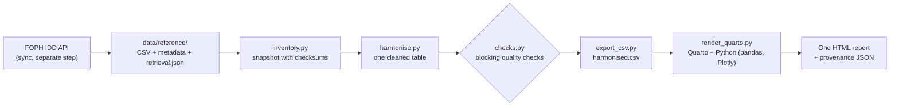

# Reproducible infectious-disease reports

This project turns the Federal Office of Public Health (FOPH) [Infectious Diseases Dashboard](https://www.idd.bag.admin.ch/) exports into interactive Quarto reports. Each report is one self-contained HTML file with interactive charts, a canton map and a machine-readable provenance record. On a simple home page you choose the stakeholder, the years and the diseases, and the report opens in a new tab.

Built for the hackathon challenge *One Data Source, Many Audiences: reproducible, parameterised communication of life-science data*.

Everything runs inside Docker, so you do not install Python or Quarto yourself.

## What you need

| Item | Notes |
|---|---|
| [Docker Desktop](https://www.docker.com/products/docker-desktop/) | Must be running (on Windows 11 it uses WSL2) |
| [VS Code](https://code.visualstudio.com/) | Optional; this guide uses its terminal |
| Internet | Only for the first build |
| About 4 GB free disk | The image is about 2.6 GB |

## First time only

1. **Start Docker Desktop** from the Start menu and wait until it says **"Engine running"** (1-2 minutes).
2. **Open the project** in VS Code: **File -> Open Folder...** -> `Health_Report_Generator`.
3. **Open a terminal**: **Ctrl+`** (the key above Tab). PowerShell is fine.
4. **Check Docker**: `docker info` should print details. `failed to connect to the docker API` means Docker Desktop is not running yet.
5. **Set two variables** (needed in every new terminal window):
   ```
   $env:LOCAL_UID=1000; $env:LOCAL_GID=1000          # PowerShell
   export LOCAL_UID="$(id -u)" LOCAL_GID="$(id -g)"   # Git Bash, Linux, macOS
   ```
6. **Build the image** (about 3 minutes, once):
   ```
   docker compose build app
   ```
   Wait for `Image health-report:local Built`.

## Make a report on the home page

1. Start Docker Desktop and set the two variables (step 5).
2. Start the page and leave the terminal open:
   ```
   docker compose up app
   ```
   Wait for `You can now view your Streamlit app in your browser.`
3. Open **http://localhost:8501** in Chrome or Edge (or in VS Code: **Ctrl+Shift+P -> Simple Browser: Show**).
4. Make your choices:
   1. **Stakeholder.** Click **Choose** on a card:
      - 🔬 *Researcher*: methods, quality checks, trends, seasonality, age groups, cantons and provenance.
      - 🏥 *Public health officials*: what needs attention now, and where.
   2. **Years.** Drag the two ends of the slider, for example 2019 to 2025. Charts and tables over time show only these years. The current status of each disease always uses the newest data, because it is compared with the previous 5 to 10 years.
   3. **Diseases.** Click a tile to select or deselect it. **Select all** and **Clear** change all of them at once.
5. Click **📄 Generate report**. The report opens in a **new tab**. If your browser blocks it, click **Open report in new tab** (or allow pop-ups for `localhost`). **Download report** and **Download provenance** save the files; they are also kept in `results/app/`.
6. To stop: press **Ctrl+C** in the terminal, then `docker compose down`.

**How long it takes.** When the page starts, it prepares both full reports in the background (seconds if nothing changed, about a minute after new data); the first click waits for that. Then: all diseases and all years about 2 seconds, a new choice about 30 seconds, the same choice again about 1 second. The page builds one report at a time.

**Optional: your own data.** Open **📂 Use your own data (optional)** and switch on *Use my own cleaned table*. Upload a `harmonised.csv` or `harmonised.parquet` made by this pipeline (or with the same columns; the page lists them), up to 500 MB. It is checked first and refused if it fails (missing columns, numbers that cannot be read, negative counts, no known disease). It is used only for your reports and the project's data is not changed. Only the diseases and years in your file are offered, and the report says at the top and in its Provenance that it was made from your file.

## Without the web page

```
docker compose run --rm report    # = snakemake --cores 2
```

This builds both full reports (all diseases, all years) into `results/site/`: `researcher.html`, `public_health.html`, their `provenance_*.json` and a landing page `index.html`. It reads the committed data in `data/reference/` and does not need GitHub credentials.

| Goal | Command |
|---|---|
| Run the page in the background | `docker compose up -d app` |
| See the log | `docker compose logs -f app` |
| Stop it | `docker compose down` |
| Download the latest FOPH data | `docker compose run --rm sync` |
| Run the tests | `docker compose run --rm report python -m pytest -q` |
| Check nothing is left to rebuild | `docker compose run --rm report snakemake --dry-run --cores 1` |
| Rebuild the image after changing `Dockerfile.report` or a requirements file | `docker compose build app` |

Editing `src/app.py` or anything in `reports/` needs no rebuild: the project folder is shared with the container, so refresh the browser page.

## What you get

| Report | Question it answers | Main content |
|---|---|---|
| **Researcher** (`reports/researcher.qmd`) | How was it measured, and can I reproduce it? | Data coverage, quality checks, methods, current status of every series, long-term trends, recent series against the comparison window, seasonality, age groups, canton map and table, limitations, provenance; the code behind every figure under "Show code" |
| **Public health officials** (`reports/public_health.qmd`) | What needs attention now, and where? | Diseases above their usual level, cantons with the highest incidence, this year against last year, respiratory season watch, how to read the report, provenance |

Every report compares each disease's latest week or month with the same week or month in the previous 5 to 10 years and labels it **Record high**, **Above normal**, **Normal** or **Low**. Each file works offline and can be emailed or put online. Its Provenance section and `provenance_<report>.json` record the source checksums, data snapshot, retrieval dates, code version, tool versions and the chosen diseases and years.

## How it works



Snakemake runs the steps once and repeats only what changed; only the last step runs per report. When you press **Generate report**:

```
your choice -> src/app.py
   -> project data: did any data or code file change since the last build?
        yes -> snakemake: data/reference -> inventory -> harmonise -> quality checks
               -> harmonised.csv -> both full reports (only what changed is rebuilt)
      your own table: upload_table.py checks it and writes results/uploads/<id>/
   -> same choice seen before (or all diseases and years)?  yes -> reuse the saved report
                                                            no  -> render_quarto.py: Quarto runs reports/<report>.qmd
   -> results/app/<report>-<id>.html opens in a new tab
```

Details: [architecture](docs/architecture.md).

## Data source

FOPH Infectious Diseases Dashboard exports from the public API (`https://api.idd.bag.admin.ch/api/v1/export/latest/<DATASET>/csv`), committed under `data/reference/` with a `retrieval.json` per dataset. The page and the build never download data by themselves: run `docker compose run --rm sync` for the latest exports. On GitHub, `.github/workflows/refresh-idd-data.yml` does this every Wednesday night (the publisher updates on Wednesdays) for the `main` branch. Please attribute **Federal Office of Public Health (FOPH/BAG), Infectious Diseases Dashboard**. See [data/README.md](data/README.md).

## Read this before using the numbers

The reports describe officially notified cases, not all infections. They are descriptive comparisons with the same period in earlier years, not significance tests, forecasts or causal claims. Colours are visual cues, not a clinical risk classification. Full list: [limitations](docs/limitations.md).

## If something goes wrong

| Problem | Fix |
|---|---|
| `failed to connect to the docker API` | Docker Desktop is not running. Start it and wait for "Engine running". |
| Docker Desktop stuck on "Starting" | Run `wsl --update`, then `wsl --shutdown`, then start Docker Desktop again. Make sure virtualization is on in BIOS and "Use the WSL 2 based engine" is ticked in Docker settings. |
| Port 8501 or 8502 already in use | In `compose.yaml` change the left number of `"8501:8501"` (page) or `"8502:8502"` (report viewer; also change `VIEWER_PORT` in `src/app.py`). |
| Permission errors writing to `results/` | Set the two variables (step 5) first. |
| **Generate report** is grey | Pick at least one disease; with *Use my own cleaned table* switched on, upload a file that passed the checks. |
| "This table cannot be used: ..." | The message names the failed check. A `harmonised.csv` from this project's `results/` always works. |
| "The report could not be built" | Run `docker compose logs app` and read the last lines. |

The page has **no login**: run it only on your own computer or a trusted network.

## More documentation

| Topic | Document |
|---|---|
| Architecture and components | [docs/architecture.md](docs/architecture.md) |
| Native setup (without Docker) and exact reproduction | [docs/reproduction.md](docs/reproduction.md) |
| Quality rules and data contract | [docs/scientific-policy.md](docs/scientific-policy.md), [SCHEMA.md](scripts/health_pipeline/SCHEMA.md) |
| Limitations | [docs/limitations.md](docs/limitations.md) |

## Tests and versions

The tests cover the data steps (subgroups never taken as totals, damaged or conflicting input blocking the quality gate, stale gates, duplicate exports, snapshot relocation and tampering, repeatable output), the CSV export, uploaded tables, the render script, the CI configuration and the toolchain contract. CI (`.github/workflows/validate.yml`) runs `fast` (Ruff, tests, dry run), `container` (builds the image and both reports inside it) and `full` (builds both reports natively, checks a rebuild is a no-op, uploads `results/site/`).

Python packages are locked in `scripts/health_pipeline/requirements.lock.txt` (pipeline and tests) and `reports/requirements.txt` (reports); `scripts/health_pipeline/requirements.txt` installs both. `workflow/toolchain.json` is the machine-readable version policy (Python 3.11.6, Quarto 1.10.19, uv 0.8.14).

Citing this work: see [CITATION.cff](CITATION.cff).
