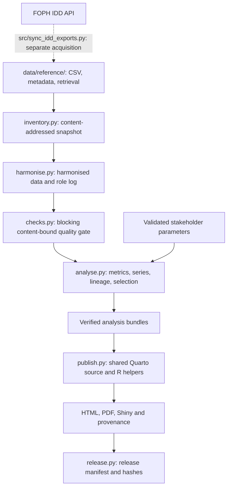

# Architecture

Scope: existing executable routes, separately from Track B targets. The [workflow-preservation policy](workflow-preservation-policy.md) is mandatory. See [conflict dispositions](b0-conflict-dispositions.md).

## Canonical IDD data flow

Snakemake expands analysis/rendering per stakeholder listed in workflow/config.yaml; shared upstream stages run once. Scientific metrics are calculated in Python and saved; formats present verified tables rather than independently recomputing them. This boundary does not promise a single physical analysis invocation across every stakeholder or route. Standard audiences use matching analytical parameters and differ in communication settings.

## Existing opt-in supplied-table route

[tabular_run.py and the reproduction guide](m4-tabular-reproduction.md) support captured, explicitly mapped UTF-8 comma CSV/tab TSV, one category, one measure and optional time. Preparation and checksum-pinned requests v1/v2 lead to descriptive results/record references, shared-source three-audience HTML rendering and exact verification. There is no implicit aggregation or enabled upload UI. Generic labels are not geography filters; period normalization is not date-window selection. Generic HTML support does not establish PDF/app support. This route does not replace canonical IDD scientific logic or data/reference/.

## Existing custom/local/connector routes

The custom-request CLI and host-local form use the custom-report cache. The GitHub-backed form is separate and renders without that cache. Legacy custom --out is replaced; preserve the previous output or use a fresh destination. No-replace publication is required for the new unified lifecycle but is not implemented by this document for legacy routes.

## Design boundaries

- One shared report entry point; no additional audience-specific QMDs. Existing canonical IDD audiences can be added through validated parameters and workflow configuration. This is not a claim that a dynamic generic profile registry or arbitrary analytical capability is shipped.
- Blocking content-bound quality gates reject stale validation. Content-addressed captured inputs support exact-snapshot replay without implicit refresh.
- Provenance is machine-readable, sidecar and embedded, retaining source/version, filters, effective parameters, software/code identities and render time.
- workflow/toolchain.json and route-specific lockfiles retain environment ownership; no wholesale runtime merge for visual adaptation.
- IDD domain eligibility/denominators and generic descriptive analysis remain separate. Presentation formats saved results; independent recalculation belongs to verification.

## Components

| Path | Role |
|---|---|
| Snakefile, workflow/ | Orchestration, configuration/schema, toolchain and R restore |
| scripts/health_pipeline/ | Pipeline, tabular preparation/rendering, publishing, cache and verification |
| scripts/health_pipeline/config/stakeholders/ | Existing profiles, including retained public-health-expert profile |
| scripts/health_pipeline/report_shared.qmd, templates/ | Shared report source, methods, R helpers/styles/apps |
| data/reference/ | Canonical committed IDD inputs and retrieval metadata |
| src/local_ui.py, src/local_report.py | Host-local form/adapter |
| src/ui.py, CONNECTOR_SETUP.md | Separate optional GitHub-backed interface |
| tests/ | Python contracts/calculations and runtime R smoke checks |

## Track B targets, not shipped architecture

[Contracts](integration-contracts.md) and the [plan](integration-plan.md) define confirmed interpretation, actual analytical selection, trusted block/profile discovery, resolved composition/publication, per-block evidence and unified lifecycle. B1 chooses strict schemas and migration rules; later stages implement them. Source/interpretation/selection, numerical analysis and presentation identities remain distinct.

The modules remain in scripts/health_pipeline/ with path-based imports rather than an installed package. A packaging/framework migration is not required merely for the composer. See [limitations](limitations.md).
