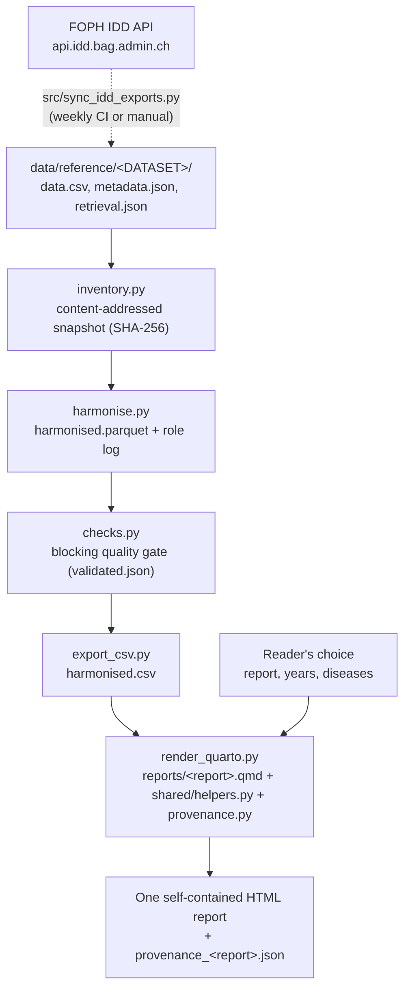

# Architecture

## Data flow

Snakemake (`Snakefile`) runs the stages and repeats only what changed. `snakemake --cores 2` builds every report listed under `reports` in `workflow/config.yaml` into `results/site/`, with all diseases and all years.

The web page (`src/app.py`) runs `snakemake` in the background when it starts, so both full reports are ready. Before each request it compares the size and modification time of every data and code file with the last successful build and runs `snakemake` again only if one changed (Snakemake's own no-op check takes several seconds on a mounted Windows folder). The full choice is then copied from `results/site/`; any other choice is rendered with `render_quarto.render()` and kept under a key of report, diseases, years and data, so it is reused.

A reader can upload their own cleaned table instead. `upload_table.py` checks it (required columns, readable numbers, no negative counts, known diseases, duplicate keys as a warning), refuses it on a failure, and writes `results/uploads/<sha256[:12]>/` with the table and companion files that describe the upload itself. `render_quarto.py` sees the `upload.json` there and the report names the uploaded file, at the top and in Provenance, instead of the FOPH sources. The project's own results are never changed.

## How a report is rendered

`render_quarto.py` copies the `.qmd`, `shared/helpers.py`, `shared/provenance.py` and `assets/swiss_cantons.geojson` into a temporary folder and runs `quarto render` there, so a failed render never replaces a good report and two renders cannot collide. It passes the choices as environment variables:

| Variable | Meaning |
|---|---|
| `HEALTH_RESULTS` | Folder holding `harmonised.csv`, `checks.csv`, `datasets.csv`, `harmonised_snapshot.json` |
| `HEALTH_TOPICS` | Diseases to include, e.g. `influenza,ehec` (empty: all) |
| `HEALTH_YEARS` | Years for the sections over time, e.g. `2019-2025` (empty: all) |
| `HEALTH_DATA_ROOT` | Raw exports, for the retrieval dates in Provenance |

Quarto runs the Python code blocks in a Jupyter kernel. `helpers.py` loads the cleaned table, computes each disease's status against its comparison window and draws the Plotly charts and canton map. `provenance.py` writes the Provenance section and the JSON beside the report. `embed-resources: true` puts everything into one HTML file.

## Design decisions

| Decision | Reason |
|---|---|
| One cleaned table for every report | Both reports and every selection read the same `harmonised.csv`, so their numbers agree. |
| Blocking quality gate | A critical check failure stops the build; the gate is bound to the content it checked, so a stale result cannot be reused. |
| Status always on full data | The current status compares with the previous 5 to 10 years. A year choice limits only the sections that show history, so it never weakens the comparison. |
| Content-addressed snapshots | The snapshot id is a hash of every input file. An archived snapshot reproduces a report without the live data tree or network. |
| Provenance as data | Each report records source checksums, snapshot, retrieval dates, code version, tool versions and the chosen diseases and years. |
| Network separated from building | Builds read only `data/reference/`. Downloading is a separate, committed, reviewable step. |
| Pinned toolchain | `workflow/toolchain.json` is the version contract; tests check Docker, Conda, CI and `pyproject.toml` against it. |

## Components

| Path | Role |
|---|---|
| `reports/researcher.qmd`, `reports/public_health.qmd` | The two reports: text, layout and the code for each section |
| `reports/shared/helpers.py` | Disease list, data loading, status, comparison windows, years and disease filters, all charts and the map |
| `reports/shared/provenance.py` | Provenance section and JSON |
| `reports/assets/` | Canton boundaries (`swiss_cantons.geojson`) and the landing page |
| `reports/requirements.txt` | Locked Python packages for the reports |
| `scripts/health_pipeline/` | Data steps (`inventory.py`, `harmonise.py`, `checks.py`, `common.py`, `export_csv.py`), `render_quarto.py`, pipeline lockfile, `SCHEMA.md` |
| `Snakefile`, `workflow/` | Orchestration, default configuration, toolchain contract |
| `src/app.py` | Home page (Streamlit): report, years, diseases; opens the report in a new tab |
| `src/sync_idd_exports.py` | Downloads the latest FOPH exports into `data/reference/` |
| `data/reference/` | Committed source data and per-dataset retrieval records |
| `Dockerfile.report`, `compose.yaml` | One image (Python 3.11.6, Quarto 1.10.19) and its services `report`, `sync`, `app` |
| `tests/` | Data steps, export, render script, CI and toolchain contracts, data sync |
| `.github/workflows/` | `validate.yml` (tests and builds), `refresh-idd-data.yml` (weekly data update) |

## Known structural limits

The pipeline modules live in `scripts/health_pipeline/` and are imported through a path insertion rather than an installed package. See [limitations](limitations.md).
