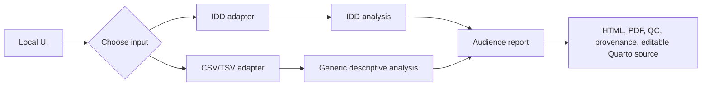
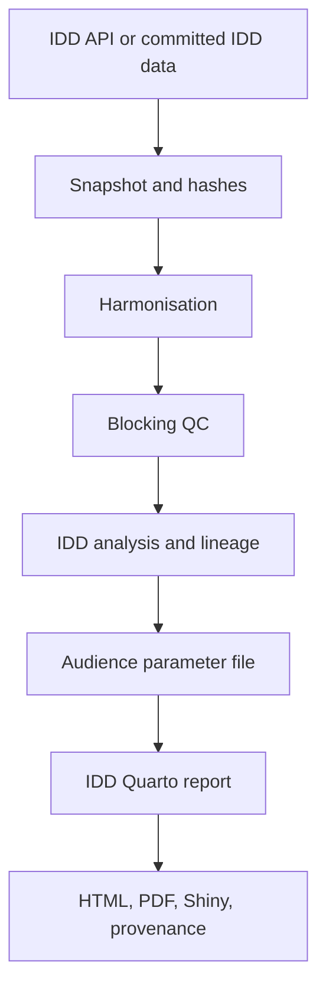
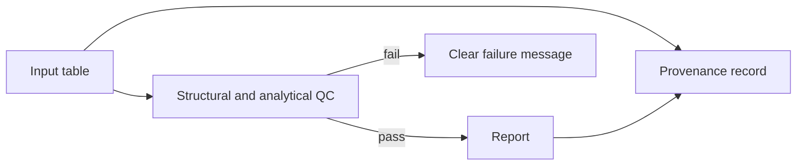

# Developer and User Guide

This guide explains the project from first start to release. It is written as
a short book: read it in order the first time, then use the chapter headings as
a reference.

## Chapter 1 — The idea

The application turns a table into a report for a chosen audience. It has one
user journey and two input adapters:



The adapters are different because IDD data has epidemiological meaning that
an arbitrary table cannot be expected to have. The reporting workflow remains
local, reproducible, and audience-aware.

## Chapter 2 — Start the project

Requirements: Docker Desktop and a clone of the repository.

```sh
docker compose build report
docker compose --profile ui up ui
```

Open <http://localhost:2718>. To stop the interface, press `Ctrl+C`.

The direct pipeline does not open a UI:

```sh
docker compose run --rm report snakemake --cores 2
```

It builds the standard IDD reports under `results/reports/`.

## Chapter 3 — Use the interface

The interface has three decisions:

1. **Audience:** Researcher, Public health, or Public.
2. **Data source:** Local IDD dataset or uploaded CSV/TSV.
3. **Generate:** Run one selected audience report.

Each run receives a timestamped folder, so a new run does not overwrite an
older run:

```text
results/runs/
├── idd/<timestamp>/
└── csv/<timestamp>/
```

## Chapter 4 — The IDD route

IDD source data are kept under `data/reference/`. Each dataset contains:

```text
data.csv
metadata.json
retrieval.json
```

The route is:



The IDD API is used for acquisition only. Report generation reads the saved
local snapshot and does not require a GitHub token.

## Chapter 5 — The CSV/TSV route

Uploaded tables do not need a mapping file. The importer makes a conservative
automatic interpretation:

- numeric columns become measures;
- text columns become descriptive groupings;
- a usable date/time column creates a time series;
- without a time column, the table becomes a snapshot;
- malformed rows or missing required structure stop the run clearly.

This route is descriptive. It must not invent disease classifications,
population denominators, incidence rates, or IDD comparison years.

Its output is kept under the selected run folder:

```text
results/runs/csv/<timestamp>/reports/<audience>/
├── report.html
├── report.qmd
├── report.css
├── methods.html
├── summary.csv
├── data.csv
└── provenance.json
```

## Chapter 6 — Quality control and provenance

QC answers whether the input can be processed safely. Provenance answers what
was used and how the output was made.

The human-readable report should explain the result plainly. The machine-
readable provenance records source name, time, audience, columns, hashes,
software, and run information. Users do not need to edit the JSON file.



## Chapter 7 — Where developers work

| Path | Purpose |
|---|---|
| `src/ui.py` | Local Marimo interface |
| `src/sync_idd_exports.py` | IDD acquisition |
| `Snakefile` | Pipeline orchestration |
| `scripts/health_pipeline/ingest_tabular.py` | CSV/TSV inspection and import |
| `scripts/health_pipeline/generic_report.py` | Generic descriptive report |
| `scripts/health_pipeline/analyse.py` | IDD-specific analysis |
| `scripts/health_pipeline/*.qmd` | IDD report sources |
| `data/reference/` | Committed IDD input |
| `results/` | Generated output; never source data |
| `tests/` | Automated contracts and regression tests |

## Chapter 8 — Test before release

Run the fast checks locally when the required environment is available:

```sh
ruff check .
python -m pytest -q
docker compose run --rm report snakemake --dry-run --cores 1
```

Test these user journeys:

1. IDD dataset with each audience.
2. CSV snapshot with no time column.
3. CSV time series with a date or period column.
4. Malformed CSV with inconsistent rows.
5. Report HTML, PDF or source, QC, and provenance outputs.

## Chapter 9 — Release checklist

Before release:

- CI passes, including the secret scan and container build.
- The working tree is clean.
- `release/v1.0.0` remains unchanged.
- The README and this guide describe the actual commands and paths.
- IDD and generic CSV reports have both been tested.
- No credentials are committed.
- `CITATION.cff`, authorship, version, and date are current.
- The release output has a matching provenance record and release manifest.

## Chapter 10 — Troubleshooting

| Symptom | Meaning | First action |
|---|---|---|
| Docker cannot connect | Docker Desktop is not running | Start Docker Desktop |
| Port `2718` is busy | Another UI is running | Stop the old container or use its existing page |
| CSV report says no complete IDD series | A generic table entered the IDD analyser | Use the generic CSV route |
| Quarto kernel times out | Rendering is using too many resources | Render with one worker and inspect the container log |
| Secret scan reports leaks | Possible historical credentials or false positives | Inspect file, line, and rule before changing anything |

## Chapter 11 — Authorship and maintenance

Every release should identify the project team and contributors in the
repository metadata and citation file. Update the `last_updated` field in this
guide when the workflow, inputs, outputs, or release instructions change.

The guide is intentionally short enough for a developer to read in one sitting.
The consolidated historical phase record is in
[`docs/project-history.md`](project-history.md); scientific policy documents
remain in `docs/` as technical evidence. This guide is the main entry point.
